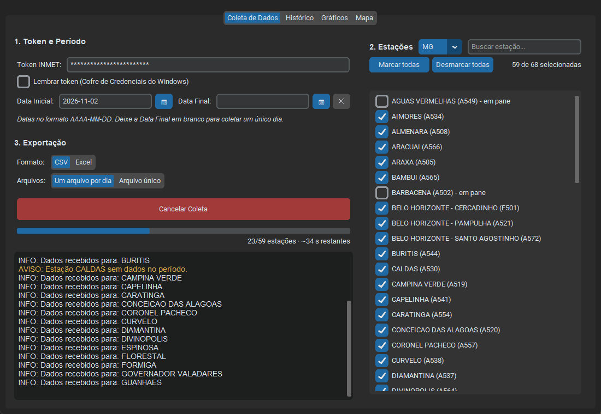
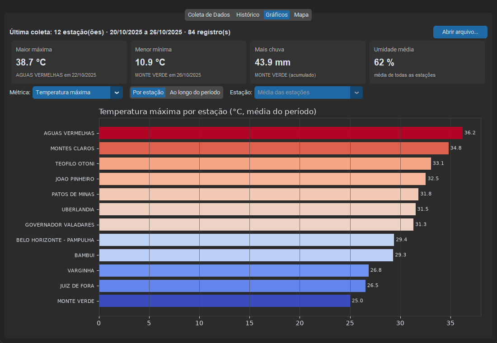
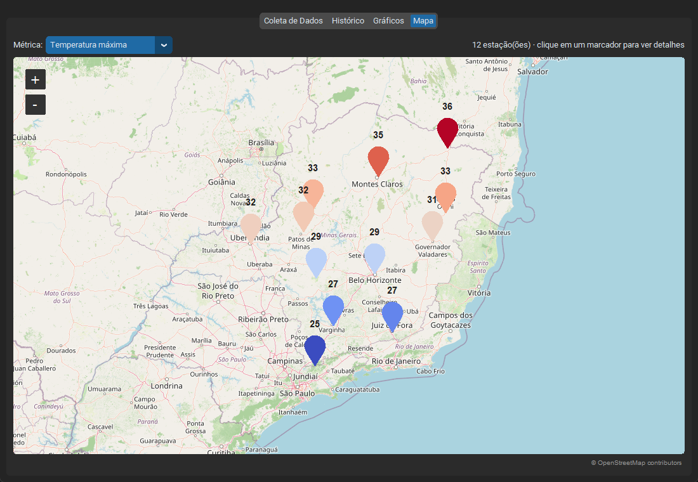
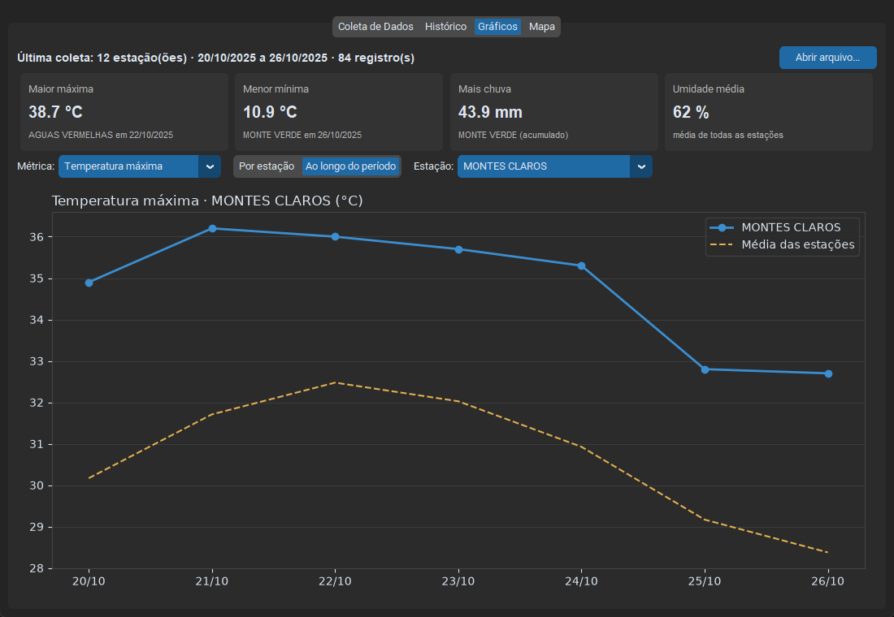
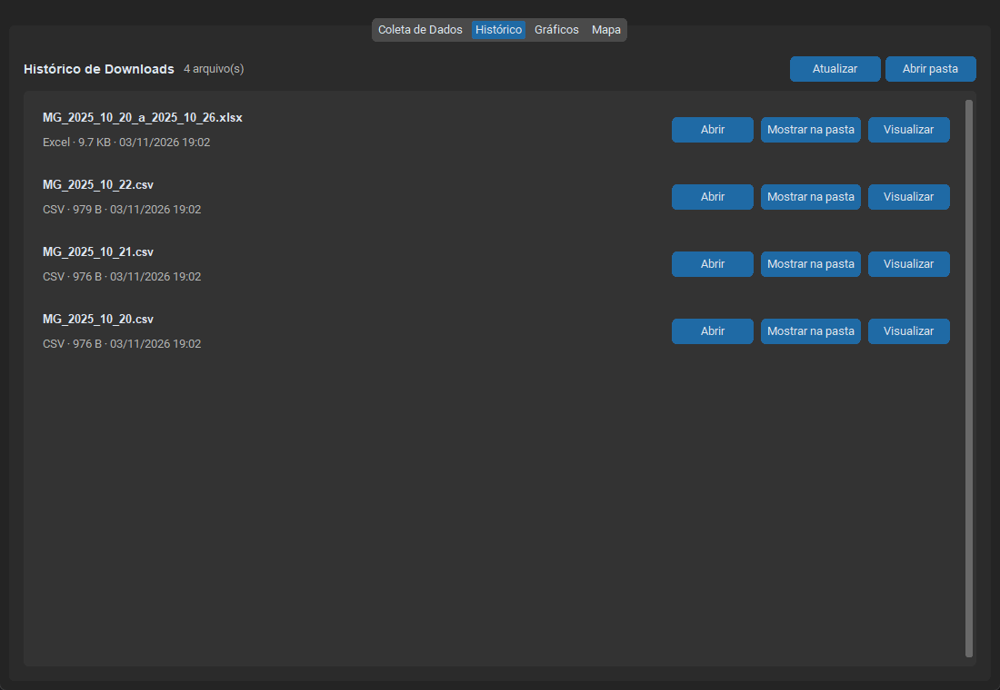
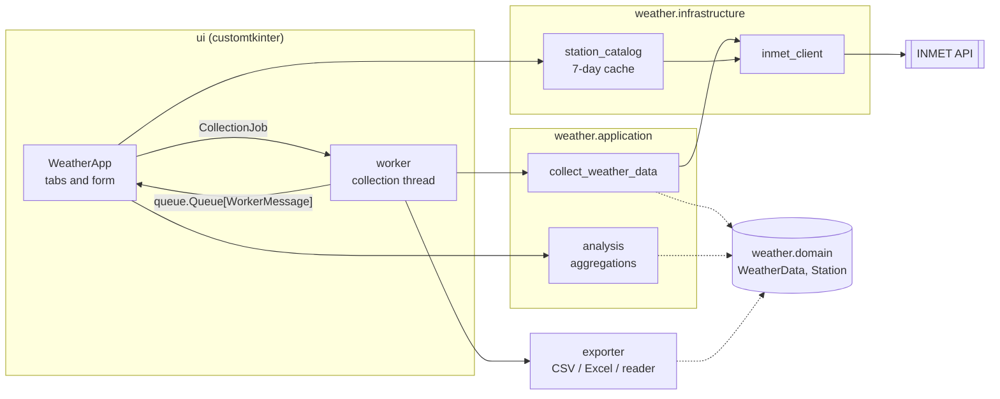

# Geoclima

[](https://github.com/PaulitoRenatito/GeoclimaProject/actions/workflows/ci.yml)
[](https://github.com/PaulitoRenatito/GeoclimaProject/releases/latest)

[](https://github.com/astral-sh/ruff)
[](LICENSE)

[Português](README.md) · **English**

Desktop app that collects daily data from the automatic weather stations of
[INMET](https://portal.inmet.gov.br/) (Brazil's National Meteorological Institute), exports it to CSV
or Excel, and shows the results in charts and on a map. Built for anyone who needs temperature, rain,
humidity and wind series from dozens of stations without assembling spreadsheets by hand.

The interface is in Brazilian Portuguese.



## Features

- **Any state, any station.** INMET's official catalog is downloaded and cached for 7 days. Search
  by name and select in bulk; stations reported as down start unchecked.
- **One day or a date range**, with a calendar picker. Today and future dates are rejected.
- **Flexible export**: CSV or Excel, one file per day or a single file for the whole range. Excel
  files get a frozen header and sized columns.
- **Progress with time estimate**, and a button to cancel at any point.
- **Token stored securely** in Windows Credential Manager (optional), never in plain text.
- **History**: open a file, show it in Explorer, or visualize any past export.
- **Charts**: highlights of the period, station ranking, and daily evolution against the average.
- **Map**: stations colored by the chosen metric; click a marker to see its value.
- **Resilient**: a failing station is logged and skipped; API calls use timeouts, retries with
  backoff, and a minimum interval between requests.

| Charts | Map |
|---|---|
|  |  |
|  |  |

## Download

Get `Geoclima.exe` from the [latest release](https://github.com/PaulitoRenatito/GeoclimaProject/releases/latest)
and run it; no Python install needed. You will need a free INMET API token, requested through the
[INMET portal](https://portal.inmet.gov.br/).

Files are saved to `Documents/Geoclima`.

## Architecture

The code is layered: the domain and the use cases know nothing about the GUI or HTTP, so they can
be tested without network access and without a window.



### Technical decisions

- **A worker thread and a queue, instead of touching the UI from the worker.** Tkinter is not
  thread-safe. Collection runs on a daemon thread and only talks to the window through a
  `queue.Queue` of typed messages, which the main loop drains every 100 ms.
- **A use case with injected dependencies.** `collect_weather_data` receives the fetch function, a
  progress listener and a cancellation `threading.Event`. Tests swap the API for a fake, and
  cancelling also interrupts the wait between requests.
- **Pydantic at the boundary.** INMET returns numbers as strings and missing values as `""`. The
  models convert them, turn blanks into `None`, and map API keys (`TEMP_MED`) to domain names
  (`temp_avg`).
- **The token never leaks.** It is part of the API URL, so network errors are re-raised without the
  URL, and the saved token lives in the system keyring.
- **Graceful catalog fallback**: fresh cache → API → stale cache → built-in list for Minas Gerais.
  The app starts even offline.
- **A map that follows OpenStreetMap's tile policy.** `tkintermapview` sends a User-Agent that OSM
  blocks; a custom fetcher identifies the app and keeps a local tile cache.

## Development

Requires Python 3.11+ and [Poetry](https://python-poetry.org/).

```bash
git clone https://github.com/PaulitoRenatito/GeoclimaProject.git
cd GeoclimaProject
poetry install
poetry run geoclima          # opens the app
```

| Task | Command |
|---|---|
| Tests + coverage | `poetry run pytest` |
| Lint and format | `poetry run ruff check src tests` · `poetry run ruff format src tests` |
| Type check | `poetry run mypy` |
| Build the executable | `poetry run pyinstaller --noconfirm geoclima.spec` → `dist/Geoclima.exe` |

CI (GitHub Actions, Windows, Python 3.11 and 3.13) runs lint, mypy and the tests with an 80%
coverage floor. Pushing a `v*` tag runs the release workflow, which builds the `.exe` and attaches
it to the release.

```
src/geoclima/
├── ui/                  # window, tabs, widgets, worker and messages
├── weather/
│   ├── domain/          # models (WeatherData, Station)
│   ├── application/     # collection use case and aggregations
│   └── infrastructure/  # INMET HTTP client and station catalog
├── exporter/            # CSV, Excel and reading exports back
├── credentials.py       # token in the keyring
└── preferences.py       # the user's last choices
tests/                   # pytest, no network (responses), one shared Tk window
```

## License

[MIT](LICENSE). Weather data from INMET; maps © OpenStreetMap contributors.
