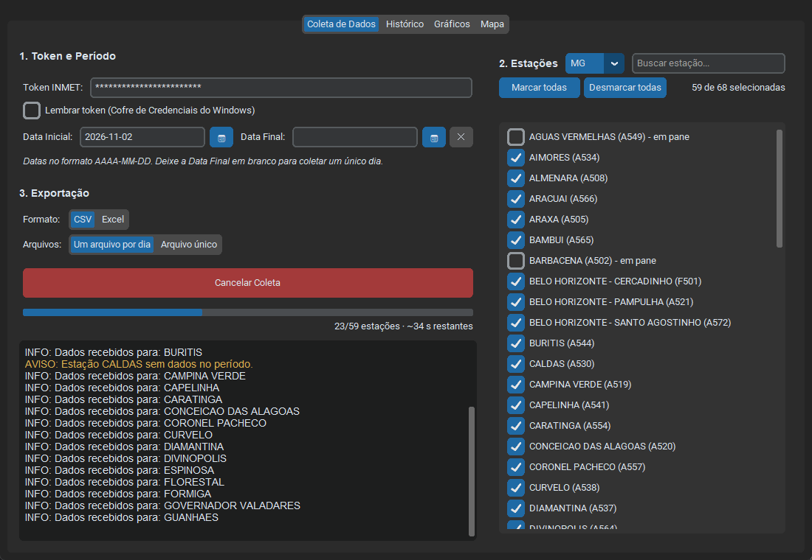
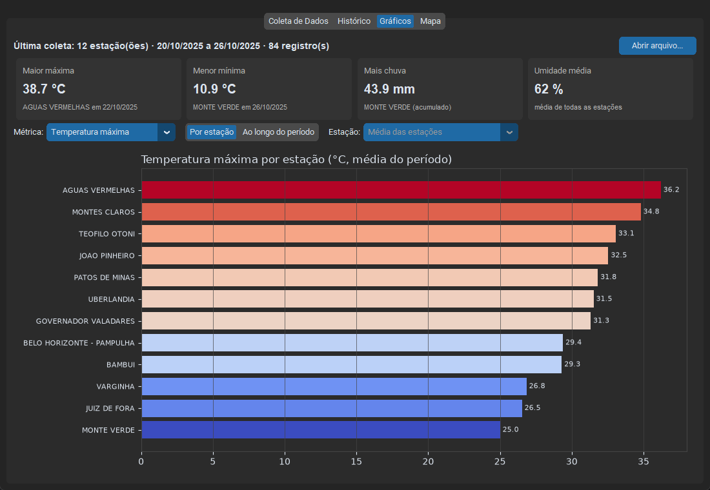
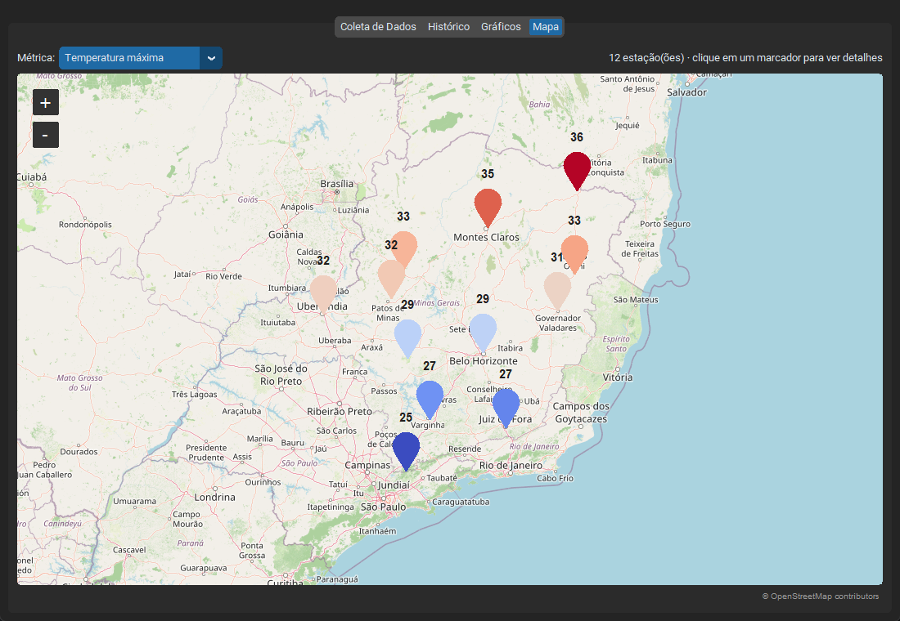
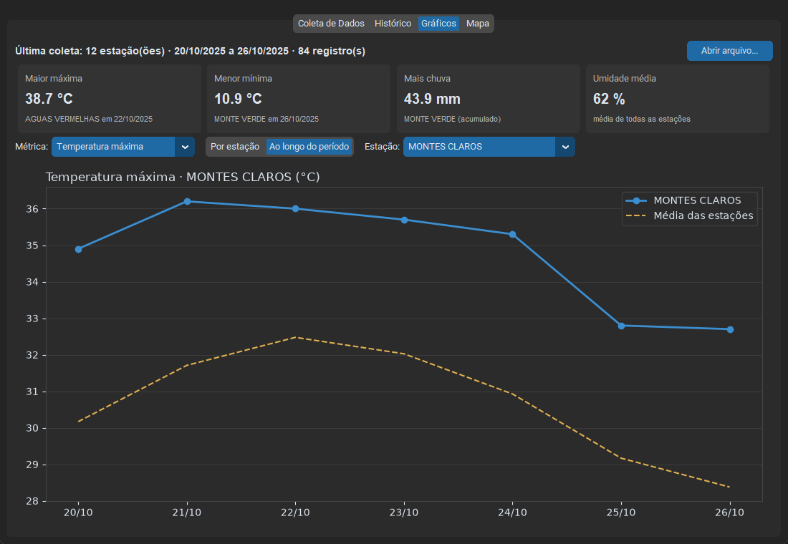
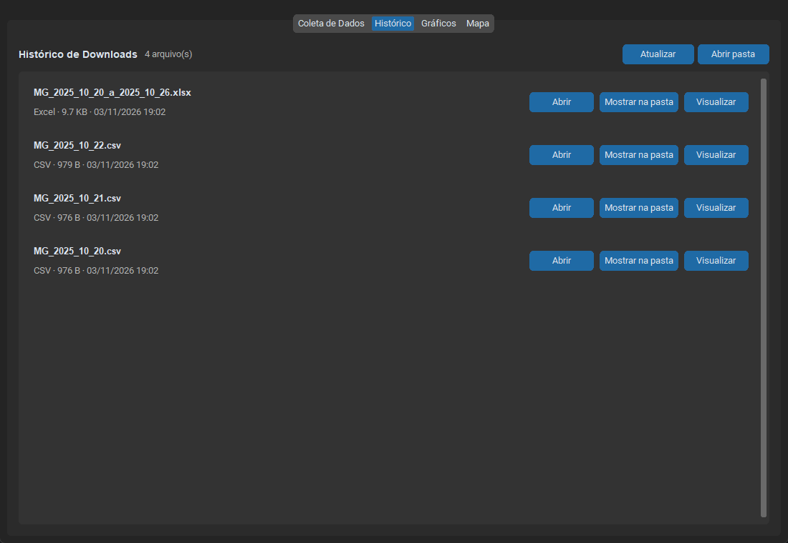
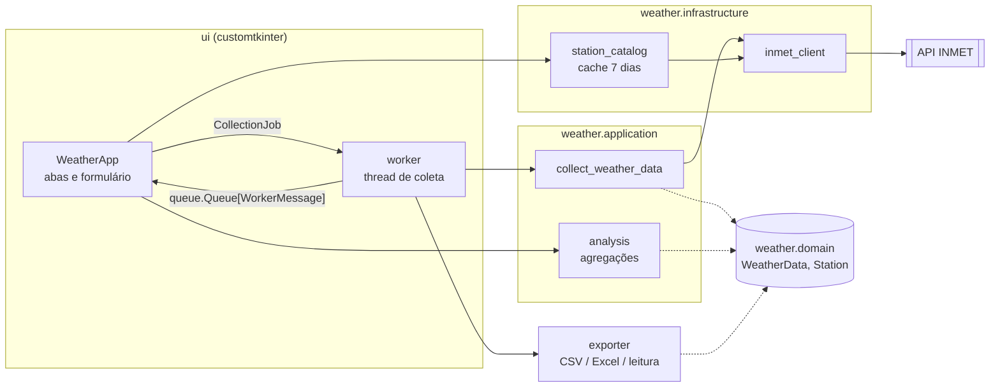

# Geoclima

[](https://github.com/PaulitoRenatito/GeoclimaProject/actions/workflows/ci.yml)
[](https://github.com/PaulitoRenatito/GeoclimaProject/releases/latest)

[](https://github.com/astral-sh/ruff)
[](LICENSE)

**Português** · [English](README.en.md)

Aplicativo desktop que coleta os dados diários das estações meteorológicas automáticas do
[INMET](https://portal.inmet.gov.br/), exporta para CSV ou Excel e mostra os resultados em gráficos e
num mapa. Feito para quem precisa de séries de temperatura, chuva, umidade e vento de dezenas de
estações sem montar planilhas na mão.



## Funcionalidades

- **Qualquer estado, qualquer estação.** O catálogo oficial do INMET é baixado e guardado em cache
  por 7 dias. Busque por nome, marque e desmarque em lote; estações em pane já vêm desmarcadas.
- **Um dia ou um período**, com calendário. Datas futuras e o dia de hoje são recusados.
- **Exportação flexível**: CSV ou Excel, um arquivo por dia ou um arquivo único para o período.
  O Excel sai com cabeçalho congelado e colunas dimensionadas.
- **Progresso com estimativa de tempo** e botão para cancelar a qualquer momento.
- **Token guardado com segurança** no Cofre de Credenciais do Windows (opcional), nunca em texto puro.
- **Histórico**: abra o arquivo, mostre na pasta ou visualize qualquer exportação antiga.
- **Gráficos**: destaques do período, ranking de estações e evolução diária comparada com a média.
- **Mapa**: estações coloridas pela métrica escolhida; clique num marcador para ver o valor.
- **Resiliente**: falhas de uma estação são registradas e a coleta continua; a API é chamada com
  timeout, novas tentativas com backoff e intervalo mínimo entre requisições.

| Gráficos | Mapa |
|---|---|
|  |  |
|  |  |

## Download

Baixe o `Geoclima.exe` na [última release](https://github.com/PaulitoRenatito/GeoclimaProject/releases/latest)
e execute; não é preciso instalar Python. Você vai precisar de um token gratuito da API do INMET,
solicitado pelo [portal do INMET](https://portal.inmet.gov.br/).

Os arquivos são salvos em `Documentos/Geoclima`.

## Arquitetura

O código segue uma separação em camadas: o domínio e os casos de uso não sabem nada de interface
gráfica nem de HTTP, o que permite testá-los sem rede e sem janela.



### Decisões técnicas

- **Thread + fila em vez de chamar a UI da thread de trabalho.** O Tkinter não é thread-safe. A coleta
  roda numa thread daemon e só conversa com a janela por uma `queue.Queue` de mensagens tipadas,
  lida a cada 100 ms pelo loop principal.
- **Caso de uso com dependências injetadas.** `collect_weather_data` recebe a função de busca, um
  listener de progresso e um `threading.Event` de cancelamento. Os testes trocam a API por um fake e
  o cancelamento interrompe até a espera entre requisições.
- **Pydantic na borda.** O INMET devolve números como texto e campos vazios como `""`. Os modelos
  convertem, transformam vazio em `None` e traduzem as chaves da API (`TEMP_MED`) para nomes de
  domínio (`temp_avg`).
- **O token nunca vaza.** Ele faz parte da URL da API, então os erros de rede são relançados sem a
  URL, e o token salvo fica no keyring do sistema.
- **Catálogo com degradação graciosa**: cache válido → API → cache vencido → lista embutida de MG.
  O app abre mesmo sem internet.
- **Mapa dentro da política do OpenStreetMap.** O `tkintermapview` usa um User-Agent que o OSM
  bloqueia; um fetcher próprio se identifica e mantém cache local dos tiles.

## Desenvolvimento

Requer Python 3.11+ e [Poetry](https://python-poetry.org/).

```bash
git clone https://github.com/PaulitoRenatito/GeoclimaProject.git
cd GeoclimaProject
poetry install
poetry run geoclima          # abre o aplicativo
```

| Tarefa | Comando |
|---|---|
| Testes + cobertura | `poetry run pytest` |
| Lint e formatação | `poetry run ruff check src tests` · `poetry run ruff format src tests` |
| Tipagem | `poetry run mypy` |
| Gerar o executável | `poetry run pyinstaller --noconfirm geoclima.spec` → `dist/Geoclima.exe` |

O CI (GitHub Actions, Windows, Python 3.11 e 3.13) roda lint, mypy e os testes com cobertura mínima
de 80%. Ao publicar uma tag `v*`, o workflow de release gera o `.exe` e o anexa à release.

```
src/geoclima/
├── ui/                  # janela, abas, widgets, worker e mensagens
├── weather/
│   ├── domain/          # modelos (WeatherData, Station)
│   ├── application/     # caso de uso de coleta e agregações
│   └── infrastructure/  # cliente HTTP do INMET e catálogo de estações
├── exporter/            # CSV, Excel e leitura de exportações
├── credentials.py       # token no keyring
└── preferences.py       # últimas escolhas do usuário
tests/                   # pytest, sem rede (responses) e com uma janela Tk compartilhada
```

## Licença

[MIT](LICENSE). Os dados meteorológicos são do INMET; os mapas, do © OpenStreetMap contributors.
